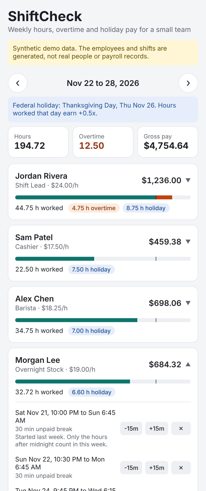

# ShiftCheck

ShiftCheck is a cross-platform mobile app (React Native with Expo, in TypeScript) that shows a small-business manager what a week of shifts will cost before payroll runs. It shows each person's regular hours, overtime past 40 hours (the FLSA and New Jersey weekly rule), hours worked on an observed federal holiday, and gross pay. The manager can nudge a shift's end time or remove a shift and watch the totals update instantly on the phone. "Check totals with server" sends the edited week to a REST API, which recomputes it using the server's own pay rates and confirms the result to the cent. Overnight shifts are split correctly at midnight and at the workweek boundary, and the holiday calendar is computed from federal law.

> **Synthetic data.** The six employees and every shift are generated by a seeded random generator. They are not real people, customers, payroll records or production traffic. The API marks every response `"synthetic": true` and the app shows a banner saying so.

- **Live app:** _deploy pending, see [Deploy](#deploy)_
- **Code:** https://github.com/nealwillis/Special



## Measured

All numbers come from real runs on 2026-10-26 (details and method in [DECISIONS.md](DECISIONS.md)):

| What | Result |
|---|---|
| Tests | **57 passing** in 5 suites (core logic, API handlers, screen), run in GitHub Actions on every push |
| Holiday accuracy | **869 of 869** observed federal holidays, 2021 to 2099, match the independent `holidays` Python package |
| Engine speed | **32.5 ms median** for 9,840 shifts (48 employees x 52 weeks), down from 48.3 ms after a fix |
| API latency (localhost, not production) | p50 1.2 ms for both endpoints, 200 sequential requests |
| Web bundle | 414 KB raw, 123 KB gzipped |

## Architecture

1. `src/core/` is plain TypeScript with no React: wall-clock time math, federal holiday rules (5 U.S.C. 6103), the overtime and pay engine, and the seeded synthetic data.
2. `src/screens` and `src/components` are the React Native UI. They run the same `summarizeWeek()` from `src/core` for instant recalculation on the device.
3. `src/server/handlers.ts` holds two Web-standard handlers: `GET /api/week?start=YYYY-MM-DD` returns the week, and `POST /api/timesheet` returns authoritative totals using the server's rates.
4. `api/*.ts` are tiny Vercel serverless functions that call those handlers. `scripts/serve.ts` serves the same handlers locally, and the tests call them directly.
5. Vercel builds `expo export --platform web` into `dist/` and serves it next to `/api`. Phones run the same code in Expo Go and reach the API at `EXPO_PUBLIC_API_URL`.

```
phone / browser ──(React Native UI)── summarizeWeek() ── instant totals
        │ GET /api/week, POST /api/timesheet
        ▼
Vercel functions ── handlers.ts ── summarizeWeek() ── authoritative totals
```

## Run it locally

Requires Node 22.

```bash
git clone https://github.com/nealwillis/Special.git shiftcheck && cd shiftcheck
npm ci
npm test                  # 57 tests
npm run typecheck         # app + serverless API

# Web app + API on one port, like production:
npm run build:web && npm run serve     # http://localhost:3000

# On a phone with Expo Go (iOS or Android), pointing at a running API:
EXPO_PUBLIC_API_URL=http://<your-computer's-LAN-IP>:3000 npx expo start

npm run measure           # re-run the numbers above (start `npm run serve` first)
```

The holiday cross-check: `npx tsx scripts/dump-holidays.ts > ours.txt && pip install holidays && python scripts/check_holidays.py ours.txt`.

## Deploy

The repo is set up for Vercel's GitHub integration (`vercel.json`: install `npm ci`, build `npm run build:web`, output `dist`, functions in `/api`). One-time setup: [import the repo on Vercel](https://vercel.com/new/clone?repository-url=https://github.com/nealwillis/Special), keep the detected settings, and Deploy. After that, every push to `main` deploys. Then:

```bash
BASE_URL=https://<your-deployment>.vercel.app npm run measure   # production latency
```

## How the pay rules work

- **Overtime** is paid time over 40 hours in a fixed Sunday to Saturday workweek, at 1.5x. There is no daily overtime (New Jersey has none).
- **Overnight shifts** are split at midnight. Each piece counts toward the day and workweek it was actually worked, so a Saturday 10 PM to Sunday 6 AM shift puts 2 hours in this week and 6 in the next.
- **Unpaid breaks** on a split shift are spread across the pieces in proportion to their length, rounded to whole minutes that add back exactly.
- **Federal holidays** are computed from the statute, with Saturday holidays observed on Friday and Sunday holidays on Monday (OPM's rule). Paid hours on the observed date earn an extra 0.5x.
- **Money** is integer cents, rounded once per employee per week.
- **Bad input** (end before start, shifts over 16 hours, a break as long as the shift, overlapping shifts) is reported per shift, kept out of the totals, and flagged in the UI.

## Known limitations

- **Not deployed yet.** Deployment needs the one-time Vercel import above; the build environment couldn't reach vercel.com. The serverless functions were compiled to CommonJS and invoked from plain Node, but haven't run on Vercel itself yet.
- **Not run on a physical phone or simulator.** It was tested with Jest (React Native renderer) and in Chromium through React Native Web. It's meant to run on iOS and Android through Expo Go, but I haven't confirmed that on a device. There is no App Store or Play Store build.
- **No persistence or login.** Edits live in memory and reset on reload; there is no database and no authentication.
- **Synthetic roster only.** You can't add employees or create shifts from scratch, only adjust or remove generated ones.
- **Time zones and DST.** Times are wall-clock with no zone, so a shift that crosses a daylight-saving change is off by one hour.
- **Simplified payroll.** Federal holidays only (no state holidays), the holiday premium stacks on overtime instead of being credited toward it (29 CFR 778.203), and there are no tip credits, time-clock rounding rules, taxes or deductions. These are estimates, not payroll or legal advice.
- **Latency numbers are local.** The 1.2 ms API figure is handler time on localhost and excludes the network.

## Repo map

```
api/                Vercel functions (thin wrappers)
src/core/           time, holidays, timesheet engine, synthetic data, summarizeWeek
src/server/         HTTP handlers + tests
src/screens/        WeekScreen + tests
src/components/     EmployeeCard
src/lib/            API client, formatting
scripts/            local server, measurements, holiday cross-check
DECISIONS.md        requirements, options considered, dated decision log
INTERVIEW.md        architecture walkthrough and likely questions
```
